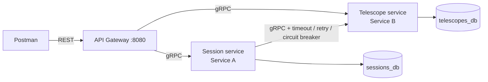

# Stargazer — Telescopes & Observation Sessions

Two collaborating Go microservices behind a REST API gateway, talking gRPC.

* **Telescope service (Service B)** owns *telescopes* (name, aperture, type, status).
* **Session service (Service A)** owns *observation sessions* (who books which telescope, on what date, to observe what). A session depends on a telescope.
* **API gateway** is the only public entry point (REST in, gRPC out).

**Business rules:** you can only book a telescope that exists *and* is `AVAILABLE`; a telescope can have only one active booking per day.

## Architecture



| Requirement | Where it lives |
|---|---|
| 1. Service B CRUD, own DB, `.proto` | `proto/telescope/v1`, `internal/telescope`, `cmd/telescope-service` |
| 2. Service A CRUD, calls B on create **and** get | `proto/session/v1`, `internal/session` |
| 3. Database per service | two Postgres containers; no foreign key across them; A only uses B's gRPC API |
| 4. API gateway, resource URLs, gRPC→HTTP mapping | `internal/gateway` (`HTTPStatus` in `http.go`) |
| 5. Timeout + retry w/ backoff + circuit breaker | `internal/session/telescope_client.go` |
| 6. Validation | `model.go` in each service, runs before any DB write |
| 7. Multi-stage Dockerfiles, one-command Compose, env vars | `docker/`, `docker-compose.yml`, `.env` |

## Run it

Prerequisite: Docker with Compose v2.

```bash
docker compose up --build
```

First start builds three images and waits for both databases to become healthy. The gateway is then on `http://localhost:8080`. Configuration (ports, DB credentials, resilience tuning) comes from `.env`.

Stop and wipe data: `docker compose down -v`.

### Try it

```bash
# 1. create a telescope
curl -s -X POST localhost:8080/telescopes -H 'Content-Type: application/json' \
  -d '{"name":"Dobsonian 8","aperture_mm":203,"type":"REFLECTOR"}'

# 2. book it (use the returned id and a future date)
curl -s -X POST localhost:8080/sessions -H 'Content-Type: application/json' \
  -d '{"telescope_id":"<ID>","observer":"Asha","date":"2030-01-15","target":"Saturn"}'

# 3. read it back (includes telescope_name fetched from Service B)
curl -s localhost:8080/sessions/<SESSION_ID>
```

Or import `postman/stargazer.postman_collection.json` into Postman and run the folders in order.

## API

| Method | URL | Success | Notes |
|---|---|---|---|
| POST | `/telescopes` | 201 + `Location` | body: `name`, `aperture_mm` (30–1000), `type` (REFRACTOR/REFLECTOR/CATADIOPTRIC), optional `status` |
| GET | `/telescopes` | 200 | |
| GET | `/telescopes/{id}` | 200 | |
| PUT | `/telescopes/{id}` | 200 | full replace; all fields required |
| DELETE | `/telescopes/{id}` | 204 | |
| POST | `/sessions` | 201 + `Location` | body: `telescope_id`, `observer`, `date` (YYYY-MM-DD, not in the past), optional `target` |
| GET | `/sessions` | 200 | optional `?telescope_id=` filter |
| GET | `/sessions/{id}` | 200 | enriched with `telescope_name` |
| PUT | `/sessions/{id}` | 200 | full replace; Service B consulted only if the telescope changes |
| DELETE | `/sessions/{id}` | 204 | |
| GET | `/health` | 200 | gateway liveness |

Errors are JSON: `{"error": "telescope \"…\" does not exist", "code": "NotFound"}`.

### gRPC → HTTP mapping

| gRPC code | HTTP | Example |
|---|---|---|
| InvalidArgument | 400 | bad date, aperture out of range, malformed JSON |
| NotFound | 404 | unknown telescope/session id |
| AlreadyExists | 409 | telescope already booked that day |
| FailedPrecondition | 409 | telescope is in maintenance |
| Unavailable | 503 (+ `Retry-After`) | Service B down or circuit open |
| DeadlineExceeded | 504 | backend too slow |
| anything else | 500 | message hidden, real cause logged |

## Resilience (Service A → Service B)

```
retry (backoff 200ms, 400ms + jitter) → circuit breaker (per attempt) → timeout (2s per attempt)
```

* **Timeout:** each attempt has its own 2 s deadline (`TELESCOPE_TIMEOUT`).
* **Retry:** up to 2 retries (`TELESCOPE_MAX_RETRIES`) with exponential backoff and jitter. Only transient errors (`Unavailable`, `DeadlineExceeded`) are retried; `NotFound` etc. are not.
* **Circuit breaker** (`sony/gobreaker`): opens after 5 consecutive failures (`BREAKER_FAILURE_THRESHOLD`), stays open 10 s (`BREAKER_OPEN_DURATION`), then lets one probe through (half-open). Business errors such as `NotFound` never count as failures.
* **Behaviour when Service B is down:** `POST /sessions` → **503** (we refuse to book something we cannot verify). `GET /sessions[/{id}]` → **200 fallback** with `telescope_details_available: false`.

### Demo

```bash
docker compose stop telescope-service
# send POST /sessions a few times: first calls retry then fail with 503, later calls fail instantly (breaker open)
docker compose logs -f session-service      # shows "retrying…" and "circuit breaker … closed -> open"
docker compose start telescope-service
# after ~10 s the breaker goes half-open -> closed and bookings work again
```

## Project layout

```
proto/                  .proto contracts (source of truth)
gen/                    generated code (make proto) — commit it
cmd/<service>/main.go   thin entry points: read env, wire dependencies, start
internal/telescope      Service B: model+validation, repository (SQL), gRPC handler
internal/session        Service A: model+validation, repository, handler, resilient B client
internal/gateway        REST handlers, JSON helpers, gRPC→HTTP error mapping
internal/platform       shared plumbing: config (env), database, gRPC server/client helpers
docker/                 one multi-stage Dockerfile per deployable
postman/                exported collection
```

Layering inside each service: **handler (gRPC) → model (rules) → repository (SQL)**. Handlers never write SQL; repositories never know about gRPC.

## Local development (without Docker)

```bash
# needs: Go 1.22+, protoc, plus the two plugins:
go install google.golang.org/protobuf/cmd/protoc-gen-go@v1.34.2
go install google.golang.org/grpc/cmd/protoc-gen-go-grpc@v1.4.0

make proto     # generate ./gen from ./proto
make tidy      # creates go.sum — commit it
make test      # unit tests: validation, retry, circuit breaker, error mapping
```

Docker builds regenerate the protobuf code themselves, so `docker compose up --build` works even before you have run these.

## Design decisions (useful for the report)

* **Database per service:** `sessions.telescope_id` is a plain column with no foreign key, because the `telescopes` table is in another database. Consistency is enforced through the gRPC call at write time.
* **No double booking, race-free:** a partial unique index `(telescope_id, session_date) WHERE status = 'BOOKED'` lets PostgreSQL enforce the rule; a violation is mapped to `AlreadyExists` → 409.
* **Validation in the services**, not only in the gateway: any client of the gRPC API gets the same protection. Invalid requests fail before any DB write.
* **gRPC dial uses `passthrough:///`** and a short reconnect backoff so Service A reconnects quickly after Service B is restarted by Docker (new IP).
* **Gateway timeout (10 s)** is deliberately longer than Service A's worst case (3 attempts × 2 s + backoff ≈ 6.6 s), otherwise the gateway would give up before the resilience logic finishes.
